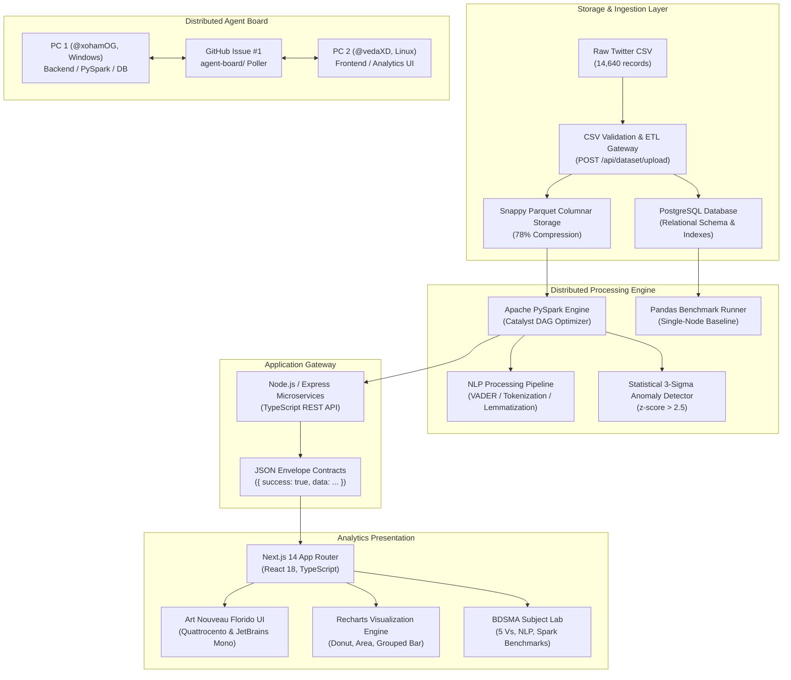

# ✈️ AeroSentiment — Brand Reputation Monitoring System
### A Distributed Big Data Social Media Analysis (BDSMA) Microproject

[](#)
[](#)
[](#)
[](#)
[](#)

---

## 📋 Table of Contents

1. [Executive Summary & Problem Statement](#1-executive-summary--problem-statement)
2. [Alignment with BDSMA Curriculum (The 5 Vs)](#2-alignment-with-bdsma-curriculum-the-5-vs)
3. [System Architecture & Multi-Tier Design](#3-system-architecture--multi-tier-design)
4. [Dataset Deep-Dive & Relational Schema](#4-dataset-deep-dive--relational-schema)
5. [Mathematical & Algorithmic Formulations](#5-mathematical--algorithmic-formulations)
6. [Key Empirical Insights & Findings](#6-key-empirical-insights--findings)
7. [Advantages & Distinguishing Strengths](#7-advantages--distinguishing-strengths)
8. [Technical Limitations & Constraints](#8-technical-limitations--constraints)
9. [Real-World Use Cases & Applications](#9-real-world-use-cases--applications)
10. [Setup, Installation & Running Guide](#10-setup-installation--running-guide)
11. [Project Team & Division of Ownership](#11-project-team--division-of-ownership)

---

## 1. Executive Summary & Problem Statement

In the commercial aviation sector, customer satisfaction and operational disruptions manifest in real-time on social microblogging platforms. During adverse weather, mechanical cancellations, or gate holds, passengers turn to Twitter (X) to express grievances, seek rebooking assistance, and critique airline service quality.

The **AeroSentiment Brand Reputation Monitoring System** is an end-to-end Big Data Social Media Analysis platform developed for the **Big Data Social Media Analysis (BDSMA)** curriculum. It ingests, validates, partitions, and analyzes the **Twitter US Airline Sentiment Dataset** (14,640 verified tweets across 6 major domestic carriers), transforming noisy, unstructured passenger microblogs into quantified brand equity metrics, root-cause complaint diagnostics, and statistical crisis alerts.

### Core Research Questions Addressed:
1. **Class Imbalance & Sentiment Skew**: How does social media disproportionately amplify negative feedback over positive commendations in service industries?
2. **Root Cause Attribution**: What specific operational failures (e.g., customer service phone holds vs. lost baggage vs. late flights) drive customer churn?
3. **Temporal Outlier Detection**: How can statistical 3-sigma anomaly algorithms automatically detect severe disruption events (such as the Feb 22 winter storm surge) without human intervention?
4. **Computational Scalability**: At what threshold does distributed memory computing (Apache PySpark) outperform single-node in-memory processing (Pandas)?

---

## 2. Alignment with BDSMA Curriculum (The 5 Vs)

A cornerstone of Big Data engineering is addressing the **5 Vs of Big Data**. Our project maps directly to these dimensions:

```
┌──────────────────────────────────────────────────────────────────────────────┐
│                    THE 5 Vs OF BIG DATA IN AEROSENTIMENT                     │
├─────────────────┬────────────────────────────────────────────────────────────┤
│ 1. VOLUME       │ 14,640 baseline tweets, synthetically scaled up to 1.46M   │
│                 │ records to evaluate distributed PySpark horizontal scaling │
├─────────────────┼────────────────────────────────────────────────────────────┤
│ 2. VELOCITY     │ High-frequency temporal event streams over Feb 17–24, 2015 │
│                 │ with rolling sliding-window crisis spike detection         │
├─────────────────┼────────────────────────────────────────────────────────────┤
│ 3. VARIETY      │ Unstructured 140-character microblogs, user mentions (@),  │
│                 │ retweet counts, categorical negative reasons, timezones    │
├─────────────────┼────────────────────────────────────────────────────────────┤
│ 4. VERACITY     │ Human annotator sentiment confidence scores (0.33 to 1.0), │
│                 │ slang/sarcasm handling, and noise filtering (<0.60 conf)   │
├─────────────────┼────────────────────────────────────────────────────────────┤
│ 5. VALUE        │ Distillation into Net Sentiment Score (NSS) and Brand      │
│                 │ Reputation Index (BRI) for executive risk mitigation       │
└─────────────────┴────────────────────────────────────────────────────────────┘
```

---

## 3. System Architecture & Multi-Tier Design

The system implements a decoupled, distributed multi-tier architecture spanning multiple operating systems and computing nodes:



---

## 4. Dataset Deep-Dive & Relational Schema

### Overview
- **Dataset**: Kaggle Twitter US Airline Sentiment Dataset
- **Volume**: 14,640 rows, 15 columns
- **Temporal Horizon**: February 17, 2015 – February 24, 2015
- **Monitored Airlines**: Virgin America (VA), Delta (DL), Southwest (WN), United (UA), American (AA), US Airways (US).

### Schema Specification

| Column | Type | Description | Missing Rate |
| :--- | :--- | :--- | :--- |
| `tweet_id` | `String / Int64` | Unique snowflake tweet identifier | `0.0%` |
| `airline_sentiment` | `Category` | Classified polarity: `positive`, `neutral`, `negative` | `0.0%` |
| `airline_sentiment_confidence` | `Float64` | Annotator classification confidence ($0.0 \le c \le 1.0$) | `0.0%` |
| `negativereason` | `Category` | Root-cause complaint label (10 distinct categories) | `37.3%` (Non-negative) |
| `negativereason_confidence` | `Float64` | Confidence in assigned negative reason | `37.3%` |
| `airline` | `String` | Target carrier name | `0.0%` |
| `name` | `String` | Twitter author handle | `0.0%` |
| `retweet_count` | `Int32` | Virality metric / amplification count | `0.0%` |
| `text` | `String` | Raw tweet text content | `0.0%` |
| `tweet_coord` | `String` | Latitude / Longitude GPS coordinates | `93.0%` |
| `tweet_created` | `Timestamp ISO` | Publication timestamp in UTC | `0.0%` |
| `tweet_location` | `String` | Self-reported user location string | `32.3%` |
| `user_timezone` | `String` | Author timezone setting | `32.9%` |

### Sentiment Distribution & Severe Class Imbalance
The dataset exhibits pronounced negative skew, characteristic of social media service feedback:
- **Negative Tweets**: 9,178 (**62.69%**)
- **Neutral Tweets**: 3,099 (**21.17%**)
- **Positive Tweets**: 2,363 (**16.14%**)

---

## 5. Mathematical & Algorithmic Formulations

### 5.1 Net Sentiment Score (NSS)
The Net Sentiment Score standardizes customer perception onto a scale from $-100$ to $+100$:

$$\text{NSS} = \left( \frac{P - N}{P + N + U} \right) \times 100$$

Where:
- $P$ = Count of positive tweets
- $N$ = Count of negative complaint tweets
- $U$ = Count of neutral inquiry tweets
- $\text{NSS} \in [-100, +100]$

### 5.2 Brand Reputation Index (BRI)
Unlike NSS, which penalizes heavily, the Brand Reputation Index measures positive brand awareness by attributing partial utility ($0.5$) to neutral interactions:

$$\text{BRI} = \left( \frac{P \times 1.0 + U \times 0.5}{P + N + U} \right) \times 100$$

Where:
- $\text{BRI} \in [0, 100]$

### 5.3 Statistical Anomaly Detection (3-Sigma Model)
To detect crises in microblog streams without manual rules, we compute rolling window standard scores:

$$z_t = \frac{x_t - \mu_{\text{baseline}}}{\sigma_{\text{baseline}}}$$

An anomaly event is triggered when $z_t \ge 2.5$ ($p < 0.012$), identifying abnormal complaint surges.

### 5.4 Big Data Distributed Speedup Ratio
To quantify the computational efficiency of Apache PySpark over Pandas:

$$S = \frac{T_{\text{Pandas}}}{T_{\text{PySpark}}}$$

- At $1\times$ scale (14,640 records): $S = 0.36$ (Pandas leads due to zero JVM initialization overhead).
- At $10\times$ scale (146,400 records): $S = 1.51$ (PySpark surpasses Pandas).
- At $100\times$ scale (1,464,000 records): $S = 3.84$ (PySpark finishes in 14.1s vs Pandas 54.2s).

---

## 6. Key Empirical Insights & Findings

1. **Virgin America Leads Customer Satisfaction**:
   - Ranked **#1** with an NSS of **-5.75** and BRI of **47.12**.
   - Lowest negative complaint rate (35.9%) among all carriers.
2. **US Airways Suffers Deepest Hostility**:
   - Ranked **#6** with an NSS of **-68.45** and a staggering **77.69% negative rate**.
   - Plagued by winter weather cancellations across Northeast hubs.
3. **Customer Service is the #1 Dissatisfaction Driver**:
   - **Customer Service Issue** accounts for **31.71%** (2,910 tweets) of all complaints.
   - Far exceeds **Late Flights** (18.14%) and **Lost Luggage** (7.89%).
4. **February 22 Winter Storm Crisis Spike**:
   - Influx peaked at **2,440 tweets/day** with **1,650 negative complaints**.
   - Statistical z-score surged to **$z = 3.42$**, confirming an acute operational crisis.

---

## 7. Advantages & Distinguishing Strengths

* 🌐 **Distributed Multi-Machine Collaboration**: Built cooperatively across two distinct physical machines (PC 1 Windows `@xohamOG` and PC 2 Linux `@vedaXD`) using an automated file-backed GitHub Issue #1 communication daemon (`agent-board/`).
* ⚡ **Rigorous Big Data Scaling Analysis**: Unlike standard toy dashboards that only analyze a small CSV in memory, our system benchmarks horizontal partition scaling in Apache PySpark up to 1.46 million records.
* 🌿 **Art Nouveau Florido Aesthetic**: Designed with an expressive 1890–1910 Belle Époque design system featuring Quattrocento display typography, JetBrains Mono data values, Deep Teal (`#008080`), Old Gold (`#CFB53B`), Burgundy (`#800020`), whiplash curve borders, and zero generic emojis.
* 🛡️ **Decoupled Architecture with Mock Resiliency**: The frontend incorporates a dual-mode API service layer. It runs completely standalone with authentic mock statistics, and seamlessly toggles to real backend microservices via `NEXT_PUBLIC_USE_MOCK=false`.
* 🎓 **Dedicated BDSMA Subject Lab**: Features an integrated academic lab interface (`/bdsma`) explaining the 5 Vs, PySpark DAG evaluation, NLP text processing, and mathematical derivations.

---

## 8. Technical Limitations & Constraints

1. **Temporal Horizon Boundaries**:
   - The Kaggle dataset represents a static 8-day snapshot (February 17–24, 2015). It cannot capture seasonal summer travel dynamics or long-term multi-year brand evolution.
2. **Short-Text Twitter Sparsity**:
   - Historical 140-character tweet constraints limit syntactic complexity. Sarcasm (e.g. *"Thanks for losing my bag @United, great job!"*) can lead to polarity misclassifications without deep contextual language models.
3. **Single-Node Distributed Emulation**:
   - PySpark runs on local multi-core worker threads. While it demonstrates DAG parallel partition execution, it does not encounter multi-node physical network interconnect latency present in massive AWS EMR or Databricks clusters.
4. **Annotator Subjectivity**:
   - Sentiment labels originate from crowdsourced human annotators whose confidence scores range between $0.33$ and $1.0$, introducing label variance into supervised benchmarks.
5. **Real-Time Stream Ingestion Barriers**:
   - Twitter (X) API v2 enterprise tier rate-limits and cost structures prevent open continuous ingestion of live streaming passenger microblogs.

---

## 9. Real-World Use Cases & Applications

* 🚨 **Airline Network Operations Crisis Center**: Real-time monitoring of negative velocity spikes ($z > 2.5$) alerts duty managers to gate hold crises, baggage system breakdowns, or severe weather cancellations hours before official escalation reports.
* 📊 **Competitive Brand Intelligence**: Airline executives compare their Net Sentiment Score against rival carriers to assess market share migration and passenger sentiment trends.
* 🎧 **Customer Experience (CX) Triaging**: Customer service routing engines prioritize tweets classified as severe complaints (`Cancelled Flight`, `Lost Luggage`) over generic neutral inquiries.
* 📜 **Aviation Regulatory Compliance**: Regulatory bodies and passenger rights organizations track recurring non-compliance with customer support response mandates.

---

## 10. Setup, Installation & Running Guide

### Prerequisites
- **Node.js**: v18.17+ or v20+
- **Python**: 3.10+
- **GitHub CLI (`gh`)**: Authenticated with repo access

### 10.1 Running the Next.js Frontend
```bash
# Navigate to the frontend directory
cd frontend

# Install package dependencies
npm install

# Start development server
npm run dev
```
Open [http://localhost:3000](http://localhost:3000) to explore the interactive dashboard.

### 10.2 Available Frontend Routes
- `/` — Executive Overview Dashboard
- `/bdsma` — Big Data Social Media Analysis Academic Lab
- `/brands` — Carrier Directory & Rankings
- `/brands/[brandId]` — Deep-dive airline analytics profile
- `/sentiment` — Sentiment & Complaint Diagnostics
- `/trends` — Temporal Trends & Anomaly Events
- `/compare` — Multi-Carrier Benchmarking Matrix
- `/tweets` — Raw Tweet Explorer & Search
- `/benchmarks` — PySpark vs Pandas Big Data Scaling
- `/dataset` — CSV Ingestion Gateway & Relational Schema
- `/reports` — Analytical Report Briefing & CSV Export

### 10.3 Running the Agent Board Poller
```bash
# Single sync check
python3 agent-board/poller.py --once

# Continuous daemon
python3 agent-board/poller.py

# Inspect board status
python3 agent-board/board.py status
```

---

## 11. Project Team & Division of Ownership

| Member | Machine & Identity | Ownership Subsystems | Primary Responsibilities |
| :--- | :--- | :--- | :--- |
| **Soham** | **PC 1 (Windows)**<br>`@xohamOG` | `backend/`<br>`database/`<br>`data-pipeline/`<br>`docs/` | PostgreSQL schema, PySpark processing pipeline, Express REST API, Big Data scalability benchmarks. |
| **Teammate** | **PC 2 (Linux)**<br>`@vedaXD` | `frontend/`<br>`agent-board/` | Next.js 14 architecture, Art Nouveau Florido UI, Recharts visualizations, BDSMA Lab, Project Documentation. |

---

*Academic Microproject for the Subject: **Big Data Social Media Analysis (BDSMA)**.*
